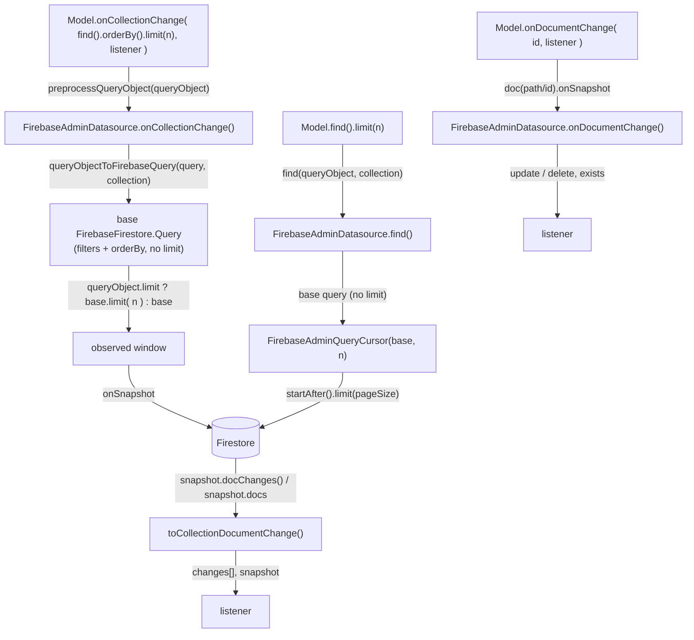

# Design — Firestore listeners report changes in the core change vocabulary (gh-issue-1)

## Abstract

`FirebaseAdminDatasource.onCollectionChange()` / `onDocumentChange()` already
translate Firestore snapshot events into the core `DocumentChange` vocabulary
(`create` / `update` / `delete`, `after` data, `before` always `undefined`,
`params.exists` for document listeners, the full result set as second argument).

One requirement is not met: `onCollectionChange()` builds its Firestore query
with `queryObjectToFirebaseQuery()`, which deliberately does **not** apply
`queryObject.limit` (the page size belongs to `FirebaseAdminQueryCursor`, see
`specs/gh-issue-2/query-cursor-design.md`). A live query therefore observes the
whole match set: `model.onCollectionChange( model.find().orderBy( 'age', 'asc' ).limit( 2 ), listener )`
delivers every matching document, reports a `create` for each, and never reports
a document leaving the window. REQ-7 and REQ-8 fail, and with them core
`entropic-bond` #18 REQ-5.

Fix: in `onCollectionChange()` only, apply `query.limit` to the Firestore query
passed to `onSnapshot()`. The cursor path, `count()` and
`queryObjectToFirebaseQuery()` stay untouched. The listener contract is stated
in JSDoc on both methods so the observable behaviour is documented where it is
implemented.

## Requirements

| REQ | Behaviour | Status | Test (scenario title) |
| --- | --- | --- | --- |
| [REQ-1](file://specs/gh-issue-1/change-snapshot.feature) | Subscribe seeds one `create` per matching document + full snapshot | pinned (pre-existing) | same title, `[REQ-1]` |
| [REQ-2] | Newly matching document reported as `create` | pinned | same title, `[REQ-2]` |
| [REQ-3] | Updated matching document reported as `update` | pinned | same title, `[REQ-3]` |
| [REQ-4] | Update that stops matching reported as `delete` | pinned | same title, `[REQ-4]` |
| [REQ-5] | Deleted matching document reported as `delete` with last data in `after` | pinned | same title, `[REQ-5]` |
| [REQ-6] | Writes/deletes that do not match are not reported | pinned | same title, `[REQ-6]` |
| [REQ-7] | Sorted+limited query observes only its window | **implemented here** | same title, `[REQ-7]` |
| [REQ-8] | A write pushing a document out of the window is reported as `delete` | **implemented here** | same title, `[REQ-8]` |
| [REQ-9] | Document deleted inside a transaction reported as `delete` | pinned | same title, `[REQ-9]` |
| [REQ-10] | Unsubscribed collection listener is not notified | pinned | same title, `[REQ-10]` |
| [REQ-11] | Every change has the core `type`, `collectionPath` and no `before` payload | pinned | same title, `[REQ-11]` |
| [REQ-12] | Query matching nothing notifies once, with no changes and empty snapshot | pinned | same title, `[REQ-12]` |
| [REQ-13] | Model listeners receive model instances in `after` and snapshot | pinned (core `Model.onCollectionChange` maps them) | same title, `[REQ-13]` |
| [REQ-14] | Subscribing to an existing document reports `update`, `exists` true | pinned | same title, `[REQ-14]` |
| [REQ-15] | Missing document stays silent until created, then `update`, `exists` true | pinned | same title, `[REQ-15]` |
| [REQ-16] | Change of the observed document reported as `update` | pinned | same title, `[REQ-16]` |
| [REQ-17] | Deletion of the observed document reported as `delete`, no `after`, `exists` false | pinned | same title, `[REQ-17]` |
| [REQ-18] | Unsubscribed document listener is not notified | pinned | same title, `[REQ-18]` |
| [REQ-19] | Model document listener receives a model instance in `after` | pinned (core `Model.onDocumentChange` maps it) | same title, `[REQ-19]` |

"Pinned" means satisfied by the current implementation and must not regress:
this change adds no code for them, only the JSDoc that states them
(REQ-1..REQ-19 documentation surface).

## Design choice: limit the listener's own query

- **Apply `query.limit` in `onCollectionChange()` (chosen)**: the listener owns
  its observed window. `baseQuery.limit( query.limit )` is passed to
  `onSnapshot()`, so Firestore delivers initial documents and later deltas
  relative to exactly the window the query describes. A write that pushes a
  document out of the window arrives as a `removed` change (REQ-8) and the
  second argument is the three-document snapshot (REQ-7).
- **Apply the limit inside `queryObjectToFirebaseQuery()` (rejected)**: that
  helper is shared with `find()` and `count()`. `find()` must pass the limit to
  `FirebaseAdminQueryCursor` as the page size, not to the base query, otherwise
  the cursor can never advance past the first page (regresses
  `specs/gh-issue-2` REQ-2/REQ-3/REQ-5), and `count()` must count every match.
- **Observe everything and trim client-side (rejected)**: the adapter never sees
  a `removed` event for a document that merely left the window, so REQ-8 is
  unsatisfiable without diffing full snapshots locally; it also reads and ships
  documents the query does not include.
- **Filter the limit away in `Model.onCollectionChange` (rejected)**: the
  translation happens after the adapter, the wrong side of the seam, and core
  must not know a data source ignored `QueryObject.limit`.
- **Document the contract in JSDoc (chosen)**: the behaviour is observable at
  the `DataSource` seam but not stated by the type signature
  (`before: undefined`, deletions leaving a result set, silence before a
  document exists). JSDoc mirrors the wording of the client datasource
  (`entropic-bond-firebase/src/store/firebase-datasource.ts`), so both adapters
  describe the same contract. No behaviour changes.

## Seams

The limit decision lives at one seam: `onCollectionChange()` decides the window,
`find()`/`queryObjectToFirebaseQuery()` are unchanged.

## Plan

1. Write this design doc.
2. In `src/store/firebase-admin-datasource.ts`:
   - `onCollectionChange()`: build the base query, then
     `query.limit ? baseQuery.limit( query.limit ) : baseQuery` before
     `onSnapshot()` (REQ-7, REQ-8).
   - Add JSDoc to `onCollectionChange()` (REQ-1, REQ-4, REQ-5, REQ-7, REQ-8,
     REQ-11, REQ-12, REQ-13, REQ-14..REQ-19 wording) and `onDocumentChange()`
     (REQ-14..REQ-19).
3. Run the emulator suite and the typecheck; no test files are written here
   (`nff-test` owns them).
4. Re-read the implementation against the feature and list any REQ that needs a
   larger change.

## Proposed changes

- `src/store/firebase-admin-datasource.ts` — `onCollectionChange()` applies
  `queryObject.limit` to the watched query: REQ-7, REQ-8.
- `src/store/firebase-admin-datasource.ts` — JSDoc on `onCollectionChange()`
  stating initial `create` seeding, full snapshot second argument, `delete` when
  a document leaves the result set, `before` always undefined: REQ-1, REQ-4,
  REQ-5, REQ-7, REQ-11, REQ-12, REQ-13.
- `src/store/firebase-admin-datasource.ts` — JSDoc on `onDocumentChange()`
  stating `after` is the current data and undefined once deleted, `before`
  always undefined, deletions are `delete` with `params.exists` false, and an
  absent document stays silent until it exists: REQ-14, REQ-15, REQ-16, REQ-17,
  REQ-19.
- No change to `queryObjectToFirebaseQuery()`, `find()`, `count()`,
  `FirebaseAdminQueryCursor`, dependencies or configuration.
- `src/store/firebase-admin-datasource.spec.ts` — one test per scenario in the
  feature (REQ-1..REQ-19), plus two supplementary window edge cases; the
  pre-existing untagged listener tests are retrofitted with their `[REQ-n]`
  tags.
- `specs/gh-issue-2/query-cursor-design.md` — the sentence claiming
  `onCollectionChange()` observes the whole collection when a limit is set is
  scoped to `find()`/`count()`, and the listener window is attributed to this
  issue, so the repo records one limit semantics.

## Best practices taken

- **Minimum change / locality**: the window decision is one expression in
  `onCollectionChange()`; the shared query builder keeps its single meaning.
- **Seam discipline**: the adapter honours the `QueryObject` it is given; core
  and the cursor seam are untouched.
- **Contract at the interface**: the invariants a caller must know
  (`before` absent, leaving-the-set deletions, silent missing document) are
  documented on the methods that implement them, matching the client adapter's
  wording.
- **Regression pins**: existing behaviour is preserved by not touching the
  helper, the cursor or `count()`.

## Strengths and weaknesses

- Live queries and paginated queries now agree on what `limit` means to their
  own consumer: a page size for `find()`, a window for a listener.
- The window is server-side; no extra documents are read or transferred.
- Ordering of `docChanges()` is whatever Firestore reports; the feature's
  ordered expectation (REQ-7) relies on the SDK ordering the initial changes in
  query order, which is outside this adapter's control and not altered here.
- A listener and a paginated query on the same `QueryObject` intentionally
  observe different cardinalities (window vs page). This is recorded in
  `specs/gh-issue-2/query-cursor-design.md` (cursor page size) and here (listener
  window), with each document pointing at the other.
- A `limit` of `0` (or no limit) watches every match; only a positive limit
  narrows the window. This matches `find()`, whose cursor treats a zero page
  size as "no limit".
